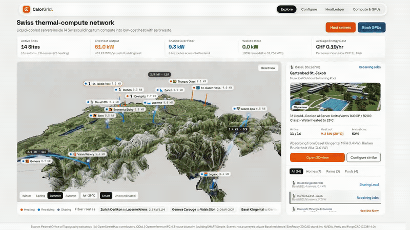

# CalorGrid

Two-sided decentralized heat-and-compute platform, 3D Swiss digital twin, conserved thermal-compute scheduler, live cloud GPU pricing engine and real CPU batch worker built by Team Invincibles (Vaibhav Motwani, Prakash Aryan and Vilas Harapanahalli) for the Sprintd Basel GreenTech Edition.

## Live Links & Deliverables

| Deliverable | Link |
|---|---|
| **Live Website Deployment (3D Web Portal)** | https://subscriptions-external-pittsburgh-aruba.trycloudflare.com/ |
| **Video Pitch & Live Portal Demo (Google Drive, no login)** | https://drive.google.com/file/d/12Og6d8koNJB6a1F6XPIgZtelmSdu8u-g/view?usp=sharing |
| **Interactive 3D Cinematic Deck & Embedded 3D Demo (HTML)** | https://calorgrid-deck.pages.dev/3d/ |
| **Interactive Pitch Deck (Excalidraw HTML)** | https://calorgrid-deck.pages.dev/ |
| **Pitch Deck (PDF)** | https://calorgrid-deck.pages.dev/CalorGrid_Round1_Deck.pdf |
| **Technical Report (PDF)** | https://calorgrid-deck.pages.dev/CalorGrid_Technical_Report.pdf |
| **Post-Hackathon Retrospective & 3D Upgrade Notes** | [docs/HACKATHON_LESSONS.md](docs/HACKATHON_LESSONS.md) |



## Two-Sided Platform Overview

CalorGrid turns compute electricity into useful building heat without operating a centralized cloud warehouse:

1. **Building Hosts (`Explore`, `Configure`, `HeatLedger`):**
   - Receive liquid-cooled server hardware at **`CHF 0` CAPEX** (`host_server_hardware_chf = 0.0`).
   - **CalorGrid pays server electricity directly** (`host_server_electricity_chf = 0.0`).
   - Keep their existing heating system (`gas_boiler`, `heat_pump` or `electric_backup`) and save specifically on their **heating bill** (`heating_bill_savings_chf`) rather than their electricity bill.
   - Strict **Host Ledger vs. Operator Ledger** separation in `configurator.py`: host savings are bounded by displaced building demand `min(Q_cg, D)` and are never double-counted into CalorGrid operator revenue.
2. **Compute / GPU Customers (`Compute / GPUs`):**
   - Book individual GPUs (`NVIDIA B200-SXM-180GB`, `H100-SXM-80GB`, `H100-NVL-94GB`, `A100-SXM-80GB`, `RTX PRO 4500 Blackwell`) or full servers across four hardware SKUs (`hydronode_1kw`, `ocp_winterfell_3kw`, `b200_ai_10kw`, `edge_micro_250w`).
   - Choose **On-Demand (`0 min` instant dispatch)** routed to year-round and summer thermal sinks (`Sole Uno Thermal Bath`, `ARA Basel Biogas Digester`, `Dreispitz Borehole Regen`, `Gartenbad St. Jakob`, `Davos Alpine Spa`) or **Spot (`50%` of On-Demand rate)** dynamically matched to Swiss partner buildings demanding heat.
   - Compare real-time On-Demand and Spot rates against traditional cloud baselines via `CloudPricingService`, generate locked quotes (`POST /api/v1/compute/quote`) and dispatch live/simulated workloads (`POST /api/v1/compute/book` with `Idempotency-Key` protection) onto `FleetJobScheduler`.

## Quickstart (CPU-only fresh clone)

Tested on Ubuntu Linux (POSIX process groups for `SIGSTOP`/`SIGCONT`). System prerequisites outside `uv`: `tesseract-ocr` (for the live `archive_ocr` worker) and Chromium or Google Chrome (for Playwright WebGL E2E tests).

```bash
uv sync
env -u PYTHONPATH uv run digitalheat verify
env -u PYTHONPATH uv run digitalheat serve --host 127.0.0.1 --port 8000
```

Open `http://127.0.0.1:8000` in Chromium to launch the **CalorGrid** 3D web platform (use `/?view=atlas` for the standalone Basel 3D Engineering Atlas view). Fresh working tree size is `96 MB` excluding `.venv` and `.git`.

Run tests and linting on CPU:

```bash
env -u PYTHONPATH uv run ruff check src/ tests/ scripts/
env -u PYTHONPATH uv run pytest tests/unit/ -v
env -u PYTHONPATH PW_CHANNEL=chrome uv run pytest tests/e2e/ -v
env -u PYTHONPATH PYTHONPATH=engines/vaibhav_scheduler/src uv run pytest engines/vaibhav_scheduler/tests/ -q
```

Verified test suite coverage: **`116` unit tests + `132` Playwright E2E tests = `248` core tests**, plus **`103` `engines/vaibhav_scheduler` unit tests** (`351` total automated tests).

If your shell sources ROS Jazzy (`PYTHONPATH` containing `/opt/ros/jazzy`), prefix commands with `env -u PYTHONPATH` (or `PYTEST_DISABLE_PLUGIN_AUTOLOAD=1`) so pytest skips external ROS `launch_testing` entrypoints.

## 520-H100 Alpine Look-Ahead Scheduler & All-In 6-Tier Cloud Economics

Beyond the 4-server Basel reference house, our look-ahead multi-GPU scheduler and full all-in TCO model evaluate **65 liquid-cooled 8×H100 servers (`520 H100 GPUs`)** deployed across six high-altitude Swiss buildings (`St. Moritz 0.5×`, `Bivio 1×`, `Zuoz 2×`, `Zermatt 4×`, `Samnaun 8×`, `Saas-Fee 16×`; `205.1 kW` mean heat need vs. `218.9 kW` supplied at `85%` load):

- **4-Step Look-Ahead Dispatch:** (1) Orders firm demand tiers before Spot (`Reserved` → `Capacity Block` → `On-Demand` preempting Spot → `Spot` running only when zero heat is dumped), (2) simulates every host building across the full job horizon to maximize displaced gas, (3) heats domestic hot water first then rooms within the `19–22 °C` comfort band, and (4) prices all 6 tiers by target margin `P = (Cost − Heat Saving) / ((1 − m) · Σ α_k H_k)`.
- **Thermal & Gas Results:** Covers **`99.3%`** of all six houses' annual heat demand (`100.0%` St. Moritz, `99.9%` Bivio/Zuoz/Zermatt/Samnaun, `98.6%` Saas-Fee), cutting annual gas bills **`−87%`** (`CHF 261,324 → CHF 33,819`; **`CHF 227,505/yr` saved**, `1.511 GWh` gas displaced).
- **All-In TCO & 20%-Margin 6-Tier Pricing:** Gross annual TCO is **`CHF 5,212,195/yr`** (`57%` hardware `CHF 2.97M` over 5 yr at `CHF 228k/srv`, `14%` electricity `CHF 729k` @ `0.3325 CHF/kWh`, `11%` maintenance, `6%` staff, `6%` installation, `6%` building/network/idle = `CHF 1.47/GPU-h` over `3.54M GPU-h`). Subtracting `CHF 227,505/yr` displaced gas yields **`CHF 4,984,690/yr`** net (`CHF 1.41/GPU-h`), break-even `P = CHF 1.00`, and **`P = CHF 1.25/GPU-h`** at `20%` net margin (**`CHF 1.25M/yr` net profit**):

| Cloud Demand Tier | Factor (`α_k`) | CalorGrid (20% m) | Specialist Median* | AWS US East | Savings (Spec / AWS) | Preemption & Dispatch Rule |
|---|---:|---:|---:|---:|---:|---|
| **Spot** | `1.00×` | **CHF 1.25** | CHF 1.97 | CHF 3.13 | **−37% / −60%** | Runs only when 0 heat dumped; preemptible |
| **Reserved** | `1.09×` | **CHF 1.36** | CHF 2.16 | CHF 3.31 | −37% / −59% | Placed first every hour; firm priority |
| **Capacity Block** | `1.64×` | **CHF 2.05** | CHF 3.24 | CHF 4.96 | −37% / −59% | Booked 24 h ahead; pushes nothing off |
| **On-Demand** | `1.82×` | **CHF 2.27** | CHF 3.60 | CHF 5.51 | **−37% / −59%** | Instant start; evicts Spot if needed |
| **Dedicated Host** | `2.00×` | **CHF 2.49** | CHF 3.96 | CHF 6.06 | −37% / −59% | Isolated full 8×H100 liquid server |
| **Serverless** | `2.73×` | **CHF 3.41** | CHF 5.40 | CHF 8.27 | −37% / −59% | 50% active duty; per-request billing |

*\*Specialist median across RunPod, Lambda, CoreWeave, and Together AI (`$4.49/h` OD). **Cautious Stress-Test:** Dropping utilization `85%→65%`, hardware life `5→4 yr`, adding `8%` cost of capital, and raising hardware cost `CHF 228k→256k` lifts break-even `P` to `CHF 1.94` (matching Specialist Spot) while remaining **`−22%` under AWS Spot (`CHF 3.13`)** even at `20%` margin (`CHF 2.43`).*

## Reference House Results (Basel 2025, N = 4 x 1 kW servers)

Workload trace assumption: `12.0` offered server-hours per server per day (`50%` 1-hour `archive_ocr` jobs + `50%` 2-hour `iiif_embeddings` jobs, 24 h diurnal arrival weights from Alibaba GPU cluster trace v2020; computing price `0.25 CHF/srv-h`).

| Metric (Basel 2025, 31,231.02 kWh demand) | Smart (Heat-Led) | Baseline (Run-on-Arrival) |
|---|---:|---:|
| Servers per house | 4 x 1 kW | 4 x 1 kW |
| Heat demand covered | 34.1% (10,643.2 kWh) | 32.7% (10,225.1 kWh) |
| Heat dumped (80% water loop) | 0.0 kWh (0.0%) | 3,790.1 kWh (27.0% of recovered) |
| Server utilisation (`N * 8760`) | 38.0% (13,304 srv-h) | 50.0% (17,519 srv-h) |
| Missed SLA deadlines (unserved jobs) | 26.3% | 0.0% |
| Electricity cost (IWB H4 `0.3325 CHF/kWh` excl. VAT) | CHF 4,423.58 | CHF 5,825.07 |
| Computing income (at `0.25 CHF/srv-h`) | CHF 3,326.00 | CHF 4,379.75 |
| OPEX break-even price | 0.2261 CHF/srv-h | 0.2549 CHF/srv-h |
| Hourly conservation residual | `3.97e-10 kWh` | `4.89e-10 kWh` |

**Where the model loses money:**
- At `0.25 CHF/srv-h`, Smart covers OPEX after heat credit (`0.2261 CHF/srv-h`) but loses money once hardware CAPEX (`1,400 CHF/server-yr` central) enters the ledger. This 4-server house at `38.0%` utilisation needs **`~0.647 CHF/srv-h`** (`0.473 CHF/srv-h` under an unlimited interruptible queue at `64.6%` utilisation; `0.386 to 0.43 CHF/srv-h` in year-round commercial or paired `Erdsonde` Verbund scenes depending on secondary-sink heat valuation).
- Smart beats Run-on-Arrival below **`~0.346 CHF/srv-h`** including heat credit (before SLA penalties). Above that price, Run-on-Arrival earns more despite dumping heat.
- Under measured HEATWISE idle power ratios (`21.0% to 26.8%`), pausing servers via OS `SIGSTOP` without deep sleep pushes Smart's break-even to `0.340 to 0.372 CHF/srv-h`, reversing its OPEX edge over Baseline (`0.325 to 0.344 CHF/srv-h`).
- Retail residential `H4` (`0.3325 CHF/kWh` excl. VAT / `0.3594` incl. 8.1% VAT) exceeds industrial `C6` (`0.2527 CHF/kWh` excl. VAT) by `0.0798 CHF/kWh`, erasing `75.0%` of the maximum `0.1064 CHF/kWh` residential heat credit. Raising the displaced heat-pump COP from `2.5` to `3.5` lifts the OPEX break-even floor from `0.2261` to `0.2565 CHF/srv-h`.
- Physical limits: the benchmark tank is lossless (`35 kWh`, 1,000 L / 30 K spread). ASHRAE W45 caps IT facility-water supply at `45 C`, so 55-60 C hygienic DHW requires preheating or auxiliary lift. The local worker reads OS PID and CPU time via `psutil` and estimates workload joules (not wall-plug metering).

## Architecture & Hardware Catalog

- `data/hardware_catalog.json`: Unified SHA-256 verified hardware catalog covering 4 server SKUs (`hydronode_1kw`, `ocp_winterfell_3kw`, `b200_ai_10kw`, `edge_micro_250w`) and 5 GPU products (`B200-SXM-180GB`, `H100-NVL-94GB`, `H100-SXM-80GB`, `A100-SXM-80GB`, `RTX PRO 4500 Blackwell`). Reconciles the 8x B200 envelope explicitly: **`1.20 kW` true standby idle**, **`7.47 kW` lowest MLPerf v5.1 active (`rgat` Offline)**, **`9.44 kW` typical (`llama3.1-8b` Offline)** and **`10.40 kW` peak (`llama2-70b-99` Offline)**.
- `src/digitalheat/fleet_scheduler.py`: `FleetJobScheduler` checking building/site thermal headroom and indoor demand across the Swiss fleet, scheduling data-center GPU slots and server workloads, reporting per-server and per-GPU real-time load plus `kW_th` heat output (`GET /api/v1/fleet/telemetry`) and advancing conserved sub-step ticks (`POST /api/v1/fleet/telemetry/tick`).
- `src/digitalheat/telemetry_log.py`: `TelemetryLogStore` (`collections.deque(maxlen=500)` ring buffer with monotonic sequence IDs and category sub-caps) surfacing `simulation_run`, `analysis_task`, `scheduler_dispatch`, `worker_lifecycle` and `customer_booking` entries via `GET /api/v1/logs`.
- `src/digitalheat/cloud_pricing.py`: `CloudPricingService` comparing CalorGrid On-Demand and Spot pricing against traditional cloud baselines for `H100`, `A100`, `B200`, `RTX PRO 4500` and all 4 server SKUs, using live keyless Azure Retail Prices + Frankfurter ECB FX with single-flight circuit-breaker refresh and cached fallback under `~/.cache/calorgrid/` (preserving `data/manifest.json` SHA-256 immutability).
- `src/digitalheat/configurator.py`: Conserved hourly simulation (`S_t + sum(eta_s * E_{s,t}) = Q_host,t + Q_secondary,t + Q_dump,t + S_{t+1}`), reactive Host thermal controls (`#hl-heat-slider` and `#hl-indoor-slider`) and strict separation of `host_ledger` vs. `operator_ledger`.
- `src/digitalheat/config.py` & `src/digitalheat/data_loader.py`: Physical/economic constants, SHA-256 dataset verification (`verify_manifest`) and UTC to `Europe/Zurich` DST localization across all 8,760 hours (`2025-03-30` 23 h spring and `2025-10-26` 25 h autumn transitions).
- `src/digitalheat/physics.py`: Hourly energy conservation engine (`residual <= 1e-6 kWh`), 7 KPIs, 5-line lumped 1-node basement air model, 7 Swiss Verbund thermal scenes (residuals `<= 7.3e-9 kWh`) and 5 Pilot Reality sensitivity modules.
- `src/digitalheat/scheduler.py` & `src/digitalheat/worker.py`: `ReferenceScheduler` (`decide_live_step`), `RunOnArrivalBaseline`, `ExternalScheduleAdapter` hook and live CPU worker (`tesseract` OCR, 2D FFT IIIF image embeddings, MFCC audio) controlled via `SIGSTOP`/`SIGCONT`.
- `src/digitalheat/api.py` & `src/digitalheat/cli.py`: FastAPI backend (`/api/v1/*`) guarded by a single `threading.RLock` in `app.state` (`--workers 1`), `Content-Security-Policy: default-src 'self'` header and zero KPI math in the browser.
- `web/`: Offline Three.js (`three@0.187.0`, MIT) Swiss Monochrome UI (`CalorGridScene`) with two-user navigation (`Building Hosts`: `Explore`, `Configure`, `HeatLedger` | `Compute Customers`: `Compute / GPUs`), 3D plant rooms defaulting to `Inside` two-loop view, real-time server/GPU slot telemetry, application log console and standalone `?view=atlas` engineering view.

## Live Web Platform & Interactive Tools

- **Explore (Swiss Network):** 3D `swisstopo` Switzerland relief map across 18 canonical fleet entries (14 core Swiss sites plus summer thermal sink anchors) with a 12-month timeline scrubber, Smart vs. Uncoordinated scheduling comparison, latency-aware routing and direct `Book GPUs` deep-links.
- **Configure (Zero-Server-Cost Host Sizer):** Opens inside the interactive 3D plant room comparing four CalorGrid-supplied server classes (`CHF 0` server hardware and `CHF 0` server electricity to hosts) with an **Already have a boiler?** toggle (`CHF 0` existing boiler tie-in vs. `43%` subsidized buffer boiler) and live two-loop piping (dielectric coolant <-> Liebert plate CDU <-> building heating water).
- **HeatLedger (Building Host Savings & Live Telemetry):** Real-time CalorGrid vs. default-heater split, reactive heating-bill savings (`Away` / `Eco` / `Auto` / `Boost` + indoor temperature target), live server/GPU workload slot thermal output (`kW_e -> kW_th`), OS worker `SIGSTOP`/`SIGCONT` dispatch and `Application & Simulation Logs`.
- **Compute / GPUs (Customer Panel):** Live/cached cloud pricing comparison (`B200`, `H100`, `A100`, `RTX PRO 4500` and 4 server SKUs), `On-Demand (0 min Instant)` vs. `Spot` quoting, interactive `POST /api/v1/compute/book` dispatch onto the live fleet scheduler and 5 Summer Sink Cost Model cards (`Sole Uno`, `ARA Basel`, `Dreispitz`, `Gartenbad St. Jakob`, `Davos`).

## Integrated Team Modules

This repository combines all Team Invincibles workstreams with preserved multi-commit and PR histories (`#1` and `#2`):

1. **CalorGrid Core Platform (`src/digitalheat/`, `web/`, `tests/unit/`, `tests/e2e/`):**
   - Conserved 8,760 h thermal-compute physics (`residual <= 7.3e-9 kWh`), `FleetJobScheduler`, `TelemetryLogStore`, `CloudPricingService`, separate Host/Operator ledgers, live CPU `SIGSTOP`/`SIGCONT` worker and Three.js 3D digital twin (`116` unit tests + `132` Playwright E2E checks = `248` core tests).
2. **HeatShift Forecast-Aware EDF Scheduler & ML Checkpoint Workers (`heatshift/`, `live/`, `workers/`, `results/`, PR `#1`):**
   - Multi-site EDF admission & proactive checkpoint-migration scheduler under noisy 36 h AR(1) weather forecasts (`sd = 1.5 C`), unplanned outage failover (`184` failovers/yr), 4-policy fleet benchmark (`Always-on`, `Thermostat`, `HeatShift`, `HeatShift + rescue`), `1-16` servers/house sweep, HSR residential heat-profile cross-check (`scripts/compare_heat_profiles.py`) and live CPU ResNet-50 / MiniLM checkpoint workers (`live/controller.py`).
3. **Cross-Hemisphere Siting, GPU-Trace `HeatSavingScheduler` & Swiss Utility Meter Data (`engines/vaibhav_scheduler/`, PR `#2`):**
   - Pure-Python (`103` unit tests) screening engine across **100 Swiss towns x 100 New Zealand towns** on the Swiss clock (`siting.py`), dynamic indoor comfort-band & hot-water draw physics (`heat.py`), multi-GPU Alibaba-trace (`689,195` jobs) `HeatSavingScheduler` vs. `FirstFreeScheduler` (`fleet.py`, `examples/dashboard_server.py`) and real anonymized **2021-2026 Swiss Gas & Electricity meter datasets** (`context/house_heat_details/`).

## Datasets, 3D Assets and Attributions

All data inputs are pinned with SHA-256 checksums in `data/manifest.json`; 3D assets are indexed in `assets/manifest.json` and `assets/attributions.json`:

- **Basel and Davos 2025 hourly reanalysis weather**: Open-Meteo historical archive (`2024-12-31` to `2025-12-31` UTC localized to `Europe/Zurich`, CC BY 4.0). Basel totals `31,231.02 kWh/yr` (`8,760 h`, `206` heating days); Davos totals `52,090.5 kWh/yr` (`291` heating days).
- **Electricity tariffs**: ElCom / LINDAS 2026 IWB Basel (`H4` residential `0.3325 CHF/kWh` excl. VAT / `0.3594 CHF/kWh` incl. 8.1% VAT; `C2` to `C6` commercial/industrial tariffs via `lindas.admin.ch`).
- **Hardware thermal telemetry**: HEATWISE OCP dataset (RISE Sweden, Zenodo `10.5281/zenodo.23237930`, CC BY 4.0).
- **AI inference benchmarks**: MLPerf Inference v5.1 Offline (`summary_results.json`, Apache-2.0); derived J/sample and CHF/1M token figures are not verified by MLCommons.
- **Swiss 3D geodata**: Source: Federal Office of Topography swisstopo (`swissBUILDINGS3D 3.0`, `swissALTI3D` 2 m DEM, `swissimage-dop10`, Open Government Data terms of use).
- **Map & site context**: OpenStreetMap via Overpass API (`(c) OpenStreetMap contributors, ODbL`, projected into Swiss LV95 via `pyproj`).
- **Interior architectural & HVAC blueprint**: buildingSMART IFC 4.3 Simple-Scene (`Building-Architecture.ifc`, `Building-Structural.ifc`, `Building-Hvac.ifc`; `(C) buildingSMART International Ltd.`, CC BY 4.0). Open reference IFC 4.3 house blueprint, not a surveyed private Basel residence.
- **Basement & datacentre 3D hardware stand-ins**: Converted to Draco+WebP `.glb` from SimReady repositories by NVIDIA (`nvidia/simready-assets`), Vertiv (`Vertiv/simready-assets`: ORV3 rack, XDU1350 CDU, NVD RPP panel) and ForgeCAD (`ForgeCAD/simready-assets`: gate valve), credited as visual CAD stand-ins (CC BY 4.0 per upstream package manifests).
- **Software libraries & license**: Three.js (MIT), Tesseract OCR (Apache-2.0), FastAPI (MIT). Project code is released under the [MIT License](LICENSE).
- **Literature context**: ETH Zurich Aquasar (Zimmermann et al., Energy 2012) and Data Furnace (Liu et al., USENIX HotCloud 2011).
