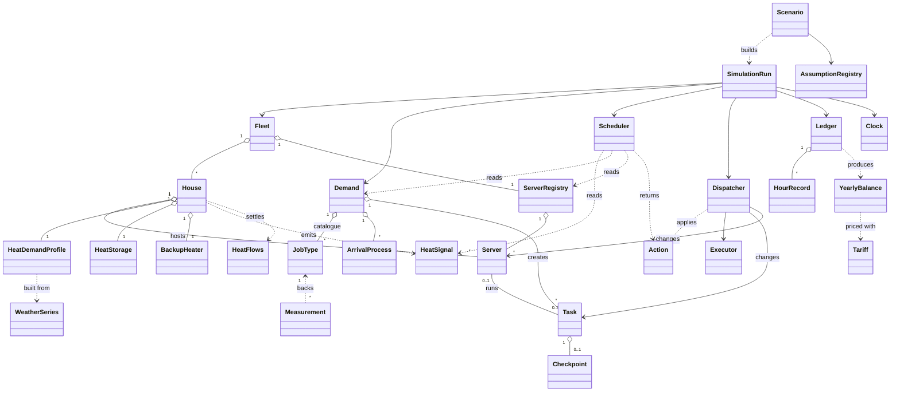
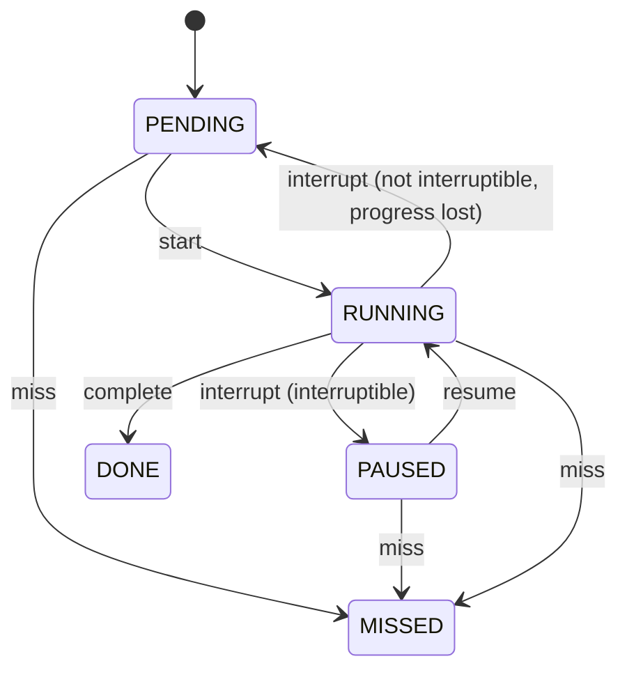

# DigitalHeat entity model

Low-level design of every entity in the model. Code lives in `src/digitalheat/`;
each section names its module.

## Overview

| Group | Entity | Module | One-line purpose |
|---|---|---|---|
| Workload | JobType | `workload.py` | Template for one kind of job |
| Workload | Measurement | `workload.py` | A timed real run that backs a JobType's numbers |
| Workload | ArrivalProcess | `workload.py` | How many jobs arrive, and when |
| Workload | Task | `workload.py` | One job instance and its lifecycle |
| Workload | Checkpoint | `workload.py` | Saved progress of a paused task |
| Workload | Demand | `workload.py` | Catalogue, arrivals and backlog |
| Compute | Server | `compute.py` | One heat-producing server in a house |
| Compute | HardwareSpec | `compute.py` | Optional machine description |
| Compute | ServerRegistry | `compute.py` | All servers and their live state |
| Heat | WeatherSeries | `heat.py` | Hourly temperature and irradiance |
| Heat | HeatDemandProfile | `heat.py` | Hourly space heating and hot water demand |
| Heat | HeatStorage | `heat.py` | The buffer tank |
| Heat | BackupHeater | `heat.py` | Covers demand the servers cannot |
| Heat | HeatSignal | `heat.py` | What a house tells the scheduler each step |
| Heat | HeatFlows | `heat.py` | Where one step's heat went |
| Heat | House | `heat.py` | Demand, tank, backup and servers of one home |
| Control | Scheduler | `scheduling.py` | Decides which task runs where |
| Control | Action | `execution.py` | One instruction: start, pause, resume, migrate |
| Control | Dispatcher | `execution.py` | Applies actions; the only writer of state |
| Control | Executor | `execution.py` | Runs jobs: simulated, or real processes |
| Reporting | Tariff | `economics.py` | Electricity price, heat value, fixed cost |
| Reporting | Ledger / HourRecord | `economics.py` | Hourly record of heat, power and income |
| Reporting | YearlyBalance | `economics.py` | The figures the brief asks for |
| Run | AssumptionRegistry | `assumptions.py` | Every constant with unit and source |
| Run | Clock | `clock.py` | Time base for simulated and live runs |
| Run | Fleet | `simulation.py` | All houses and servers |
| Run | Scenario | `simulation.py` | The knobs of one experiment |
| Run | SimulationRun | `simulation.py` | The step loop |

## One step of the run

`SimulationRun.step()` does the following for step `t` (one hour):

1. `Demand.step` creates the tasks that arrive this hour.
2. `Demand.overdue` finds tasks that can no longer meet their deadline; the Dispatcher drops them (MISSED).
3. Each House emits a `HeatSignal` (demand, tank level, tank headroom, forecast).
4. `Scheduler.decide` returns a list of `Action`s. It changes nothing.
5. `Dispatcher.apply` carries them out on tasks, servers and the Executor.
6. Running servers do an hour of work; finished tasks are closed.
7. `House.settle` splits the server heat into direct use, tank charge and dump, and covers remaining demand from the tank and then the backup heater.
8. A `HourRecord` goes into the Ledger.

The same loop drives a live run: swap `SimulatedExecutor` for `ProcessExecutor` and give the Clock a `seconds_per_step`.

## Workload

### JobType

| Field | Type | Meaning |
|---|---|---|
| `id`, `name` | str | Identifier and display name |
| `runtime_h` | float | Runtime on the reference server |
| `power_kw` | float | Draw while running |
| `interruptible` | bool | If False, a pause loses all progress |
| `price_chf_per_server_hour` | float | Computing income per running hour |
| `source` | str | Where the numbers come from (required) |
| `relative_deadline_h` | float or None | Hours from arrival to deadline |
| `checkpoint_overhead_h` | float | Extra work caused by one interruption |
| `region_constraint` | str or None | Region the job must stay in |
| `priority` | int | Higher runs first |
| `measured` | bool | True if timed on our own machine |

Derived: `energy_kwh = runtime_h × power_kw`. Rejects an empty source and a deadline shorter than the runtime.

### Measurement

Records a real run: machine, `runtime_s`, `avg_power_w`, method (`software_meter` or `runtime_x_power`), date and `jobs_in_run`. `reference_runtime_h()` scales the job to the reference server by keeping energy per job constant.

### ArrivalProcess

One per job type. Modes:

| Mode | Behaviour |
|---|---|
| `UNLIMITED` | Keeps `buffer` jobs waiting at all times (set it to at least the number of servers) |
| `FIXED_DAILY` | `jobs_per_day` spread by a 24-value `hourly_shape`; deterministic |
| `POISSON` | Same mean rate, random counts from `seed` |
| `TRACE` | Explicit arrival steps, e.g. sampled from a cluster trace |

### Task

Copies its job type's fields at creation, then tracks state.

| State field | Meaning |
|---|---|
| `status` | PENDING, RUNNING, PAUSED, DONE or MISSED |
| `work_done_h`, `overhead_h` | Progress, and extra work added by interruptions |
| `server_id`, `last_server_id` | Where it runs now, and where it last ran |
| `checkpoint` | Saved progress while PAUSED |
| `run_hours`, `interruptions`, `migrations`, `restarts` | Counters |

Key derived values: `remaining_h`, and `slack_h(now) = deadline − now − remaining` (infinite without a deadline). A task with negative slack is dropped.

### Demand

Owns the catalogue, the arrival processes and every task. Views: `backlog()`, `running()`, `eligible(now, region)` sorted by urgency, `overdue(now)`, `stats()` and `missed_deadline_pct()`.

Invariants: every task refers to a catalogued job type; the same seeds give the same arrivals; a task leaves the open set only as DONE or MISSED.

## Compute

### Server

| Field | Meaning |
|---|---|
| `id`, `house_id`, `region` | Identity and location |
| `power_kw`, `heat_recovery_fraction`, `idle_power_kw` | Electrical and thermal behaviour |
| `state` | OFF, RUNNING or FAILED |
| `task_id` | The task it runs, if any |
| `throttle` | 0–1; scales power and progress together |
| `running_hours`, `electricity_kwh`, `heat_kwh` | Meters |
| `hardware`, `address` | Optional: machine description, executor address |

A server runs at most one task. Recoverable heat = `min(task power, server power) × throttle × heat_recovery_fraction`.

### ServerRegistry

Lookups by id, house, region and state, plus `snapshot()` for a dashboard. This is the "server list and metadata" part of a load balancer; the decision part is the Scheduler.

## Heat

### WeatherSeries and HeatDemandProfile

`WeatherSeries.from_open_meteo_csv` reads the hourly archive file. `HeatDemandProfile.reference_house` applies the brief's formula: space heating = `max(0, 10 kW × (20 − T) ÷ 25.6)` on days whose mean hourly temperature is below 12 °C, plus 12 kWh of hot water per day. `from_shape` and `from_csv` build other houses.

### HeatStorage and BackupHeater

The tank has `capacity_kwh`, `soc_kwh` and an optional loss rate; `charge` and `discharge` return what was actually moved. The backup heater supplies whatever is still missing and tracks its electricity at the heat pump COP.

### HeatSignal

`demand_kwh`, `tank_soc_kwh`, `tank_headroom_kwh`, `forecast_kwh`. The key value is `absorbable_kwh = demand + tank headroom`: the server heat a house can take this step without dumping any.

### House and HeatFlows

`House.settle(t, server_heat)` returns `HeatFlows`, which always satisfies:

- server heat = direct + to tank + dumped
- demand = direct + from tank + backup

## Control

### Scheduler

Interface: `decide(now_h, signals, demand, registry) -> list[Action]`. Pure: it reads and returns, and never changes state.

`HeatFollowingScheduler` is the baseline. Per house, neediest first:

1. Keep running tasks while their heat is absorbable. Tasks that cannot be paused, or would miss their deadline if paused, always stay.
2. Fill the remaining heat budget with waiting tasks, most urgent first. Tasks displaced from another house are candidates, which is how work migrates.
3. Tasks about to miss their deadline run even if their heat is dumped (`allow_dump_for_deadlines`).

### Action, Dispatcher, Executor

`Action(type, task_id, server_id, reason)` with type START, PAUSE, RESUME or MIGRATE; `reason` is a plain-language explanation for the log. The Dispatcher frees servers first, then places tasks, and is the only code that changes task and server state. `SimulatedExecutor` does bookkeeping; `ProcessExecutor` runs real processes and pauses them with SIGSTOP / SIGCONT.

## Reporting

`Ledger.balance()` produces a `YearlyBalance` per house:

| Figure | Definition |
|---|---|
| Covered share | (direct + from tank) ÷ heat demand |
| Heat dumped | Server heat that neither demand nor tank could take |
| Utilisation | Running server-hours ÷ (servers × hours) |
| Missed deadlines | MISSED ÷ (DONE + MISSED), tasks with a deadline, fleet-wide |
| Electricity cost | Server kWh × electricity price |
| Heat value | Covered kWh × electricity price ÷ COP |
| Computing income | Running server-hours × job price |
| Net | Income + heat value − electricity cost − fixed cost |
| Break-even price | (Electricity cost + fixed cost − heat value) ÷ running server-hours |

With no dumped heat the break-even price is `electricity price × (1 − recovery ÷ COP)`.

## Modelling choices to challenge

| Choice | Current setting | Why it matters |
|---|---|---|
| Idle servers | Switched off, 0 kW | Any idle draw raises cost in summer |
| Hot water | Spread evenly over 24 h | A morning/evening shape changes tank use |
| Tank | Starts empty, no losses | Losses reduce summer coverage |
| Billing | Every running server-hour earns the job price | Missed jobs still earn for hours run |
| Missed tasks | Dropped once the deadline is unreachable | Alternative: finish late with a penalty |
| Short jobs | Batched into tasks of an hour or more | A server idles for the rest of an hour after a short task |
| Forecast | Perfect, read from the profile | A real system needs a weather forecast |
| Fixed costs | 0 CHF per server-year | Hardware cost decides whether a pilot pays off |
| Electricity | Flat price, one house tariff | No day/night or spot pricing |

## Not modelled yet

- Solar PV and the "Prepper" stretch goal (irradiance is already loaded).
- Customers, contracts and job submission.
- Network cost and time of moving job data between houses.
- Server failures in the run loop (`Dispatcher.fail_server` exists but nothing triggers it).