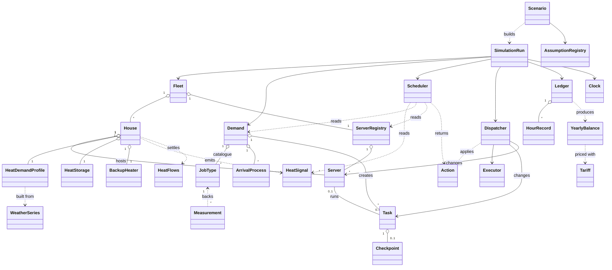
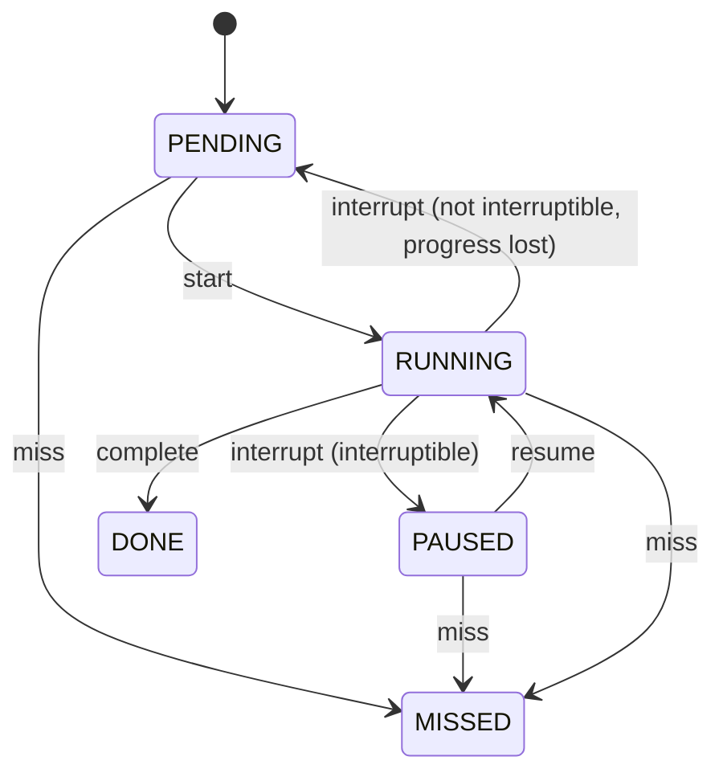

# DigitalHeat entity model

Low-level design of every entity in the model. Code lives in `src/digitalheat/`;
each section names its module.

## Overview

| Group | Entity | Module | One-line purpose |
|---|---|---|---|
| Workload | JobType | `workload.py` | Template for one kind of job |
| Workload | Measurement | `workload.py` | A timed real run that backs a JobType's numbers |
| Workload | ArrivalProcess | `workload.py` | How many jobs arrive, and when |
| Workload | Task | `workload.py` | One job instance and its lifecycle |
| Workload | Checkpoint | `workload.py` | Saved progress of a paused task |
| Workload | Demand | `workload.py` | Catalogue, arrivals and backlog |
| Workload | TraceJob | `workload.py` | A real task from a cluster trace: GPUs and run time |
| Workload | Placement | `workload.py` | A trace job put on a server at a given hour |
| Compute | Server | `compute.py` | One heat-producing server in a house |
| Compute | PowerProfile | `compute.py` | A system's measured power at full load on one benchmark |
| Compute | HardwareSpec | `compute.py` | Optional machine description |
| Compute | ServerRegistry | `compute.py` | All servers and their live state |
| Heat | WeatherSeries | `heat.py` | Hourly temperature and irradiance |
| Heat | HeatDemandProfile | `heat.py` | Hourly space heating and hot water demand |
| Heat | Building | `heat.py` | Indoor temperature drifting inside a comfort band |
| Heat | HotWaterTank | `heat.py` | The domestic hot water store and its draws |
| Heat | HouseHeatModel | `heat.py` | Hourly heat a house needs and can absorb |
| Heat | HeatStorage | `heat.py` | The buffer tank |
| Heat | BackupHeater | `heat.py` | Covers demand the servers cannot |
| Heat | HeatSignal | `heat.py` | What a house tells the scheduler each step |
| Heat | HeatFlows | `heat.py` | Where one step's heat went |
| Heat | House | `heat.py` | Demand, tank, backup and servers of one home |
| Control | Scheduler | `scheduling.py` | Decides which task runs where |
| Control | Site | `fleet.py` | One house with its heat model, weather, servers and booked GPUs |
| Control | QueuedJob | `fleet.py` | A trace job with an arrival, a deadline and a rising priority |
| Control | HeatSavingScheduler | `fleet.py` | Sends each job where its heat avoids the most backup heating |
| Control | FirstFreeScheduler | `fleet.py` | Baseline: first come first served, first house with room |
| Control | FleetRun | `fleet.py` | The hourly loop over several houses and its records |
| Control | Action | `execution.py` | One instruction: start, pause, resume, migrate |
| Control | Dispatcher | `execution.py` | Applies actions; the only writer of state |
| Control | Executor | `execution.py` | Runs jobs: simulated, or real processes |
| Reporting | Tariff | `economics.py` | Electricity price, heat value, fixed cost |
| Reporting | ServerCosts | `economics.py` | Prices behind the cost of running servers and the value of their heat |
| Reporting | Balance | `economics.py` | Each cost for a period, the heat saving and the break-even GPU-hour price |
| Reporting | Ledger / HourRecord | `economics.py` | Hourly record of heat, power and income |
| Reporting | YearlyBalance | `economics.py` | The figures the brief asks for |
| Run | AssumptionRegistry | `assumptions.py` | Every constant with unit and source |
| Run | Clock | `clock.py` | Time base for simulated and live runs |
| Run | Fleet | `simulation.py` | All houses and servers |
| Run | Scenario | `simulation.py` | The knobs of one experiment |
| Run | SimulationRun | `simulation.py` | The step loop |

## One step of the run

`SimulationRun.step()` does the following for step `t` (one hour):

1. `Demand.step` creates the tasks that arrive this hour.
2. `Demand.overdue` finds tasks that can no longer meet their deadline; the Dispatcher drops them (MISSED).
3. Each House emits a `HeatSignal` (demand, tank level, tank headroom, forecast).
4. `Scheduler.decide` returns a list of `Action`s. It changes nothing.
5. `Dispatcher.apply` carries them out on tasks, servers and the Executor.
6. Running servers do an hour of work; finished tasks are closed.
7. `House.settle` splits the server heat into direct use, tank charge and dump, and covers remaining demand from the tank and then the backup heater.
8. A `HourRecord` goes into the Ledger.

The same loop drives a live run: swap `SimulatedExecutor` for `ProcessExecutor` and give the Clock a `seconds_per_step`.

## Workload

### JobType

| Field | Type | Meaning |
|---|---|---|
| `id`, `name` | str | Identifier and display name |
| `runtime_h` | float | Runtime on the reference server |
| `power_kw` | float | Draw while running |
| `interruptible` | bool | If False, a pause loses all progress |
| `price_chf_per_server_hour` | float | Computing income per running hour |
| `source` | str | Where the numbers come from (required) |
| `relative_deadline_h` | float or None | Hours from arrival to deadline |
| `checkpoint_overhead_h` | float | Extra work caused by one interruption |
| `region_constraint` | str or None | Region the job must stay in |
| `priority` | int | Higher runs first |
| `measured` | bool | True if timed on our own machine |

Derived: `energy_kwh = runtime_h × power_kw`. Rejects an empty source and a deadline shorter than the runtime.

### Measurement

Records a real run: machine, `runtime_s`, `avg_power_w`, method (`software_meter` or `runtime_x_power`), date and `jobs_in_run`. `reference_runtime_h()` scales the job to the reference server by keeping energy per job constant.

### ArrivalProcess

One per job type. Modes:

| Mode | Behaviour |
|---|---|
| `UNLIMITED` | Keeps `buffer` jobs waiting at all times (set it to at least the number of servers) |
| `FIXED_DAILY` | `jobs_per_day` spread by a 24-value `hourly_shape`; deterministic |
| `POISSON` | Same mean rate, random counts from `seed` |
| `TRACE` | Explicit arrival steps, e.g. sampled from a cluster trace |

### Task

Copies its job type's fields at creation, then tracks state.

| State field | Meaning |
|---|---|
| `status` | PENDING, RUNNING, PAUSED, DONE or MISSED |
| `work_done_h`, `overhead_h` | Progress, and extra work added by interruptions |
| `server_id`, `last_server_id` | Where it runs now, and where it last ran |
| `checkpoint` | Saved progress while PAUSED |
| `run_hours`, `interruptions`, `migrations`, `restarts` | Counters |

Key derived values: `remaining_h`, and `slack_h(now) = deadline − now − remaining` (infinite without a deadline). A task with negative slack is dropped.

### Demand

Owns the catalogue, the arrival processes and every task. Views: `backlog()`, `running()`, `eligible(now, region)` sorted by urgency, `overdue(now)`, `stats()` and `missed_deadline_pct()`.

Invariants: every task refers to a catalogued job type; the same seeds give the same arrivals; a task leaves the open set only as DONE or MISSED.

### TraceJob and Placement

`TraceJob` is a real task from the Alibaba GPU cluster trace 2020: the GPUs it asked for (`inst_num × plan_gpu ÷ 100`) and how long it ran. `scripts/fetch_workloads.py` picks fifteen of them, the task at the median, 90th and 99th percentile of duration in each of five size groups that fit one 8-GPU server, and writes them to `data/alibaba_gpu_jobs.json`; `load_trace_jobs` reads that file. A `Placement` puts a job on a server from a start hour, once or repeated back to back for a number of hours. `gpu_hours_by_step` adds up what the placements on one server ask for in each step; a value above the server's GPUs means it is overbooked.

## Compute

### Server

| Field | Meaning |
|---|---|
| `id`, `house_id`, `region` | Identity and location |
| `power_kw`, `heat_recovery_fraction`, `idle_power_kw` | Electrical and thermal behaviour |
| `state` | OFF, RUNNING or FAILED |
| `task_id` | The task it runs, if any |
| `throttle` | 0–1; scales power and progress together |
| `running_hours`, `electricity_kwh`, `heat_kwh` | Meters |
| `hardware`, `address` | Optional: machine description, executor address |

A server runs at most one task. Recoverable heat = `min(task power, server power) × throttle × heat_recovery_fraction`.

### PowerProfile

`PowerProfile` is one MLPerf Inference result with a power measurement: a system, a benchmark, and the average wall power while it runs at full load (`data/mlperf_power.json`, read by `load_power_profiles`). `power_kw(gpus_busy)` scales that power by the share of GPUs working and is zero when nothing runs. A server's heat in a step is that electricity times the heat recovery fraction. `examples/workload_viz.py` combines placements, a profile per server and the `HouseHeatModel` for one day. The run loop and the scheduler do not use these yet.

### ServerRegistry

Lookups by id, house, region and state, plus `snapshot()` for a dashboard. This is the "server list and metadata" part of a load balancer; the decision part is the Scheduler.

## Heat

### WeatherSeries and HeatDemandProfile

`WeatherSeries.from_open_meteo_csv` reads the hourly archive file. `HeatDemandProfile.reference_house` applies the brief's formula: space heating = `max(0, 10 kW × (20 − T) ÷ 25.6)` on days whose mean hourly temperature is below 12 °C, plus 12 kWh of hot water per day. `from_shape` and `from_csv` build other houses.

### Building

`Building` treats the indoor temperature as a state instead of a fixed 20 °C: `C × dT_in/dt = heat delivered − H × (T_in − T_out)`, with `H` = 10 kW ÷ 25.6 K from the brief and `C` the heat stored per degree. The temperature may drift between `min_temp_c` and `max_temp_c` (19 to 22 °C by default). `min_heat_kwh` and `max_heat_kwh` give the least and most heat the house can take in a step, and `apply` advances the temperature. With a zero-width band at 20 °C both equal the brief's formula. `Scenario.building()` builds it from the registry. The run loop does not use it yet: `House.settle` still serves the fixed-setpoint profile.

### HotWaterTank and HouseHeatModel

`HotWaterTank` is defined by volume and temperature (300 L from 10 to 55 °C holds 15.7 kWh). It stays full of water; each draw replaces hot water with cold, so its heat level falls. `HouseHeatModel` combines it with the `Building` and returns a `HeatRange` for each step:

- space heating: the least heat keeps the rooms at the lower limit, the most would bring them to the upper limit, capped by what the heating system can deliver
- hot water: the least heat keeps the tank at its reserve, the most refills it

`deliver(server_heat, ...)` advances one step and returns a `HeatDelivery`: server heat covers the must-run amounts first, then refills the tank, then warms the rooms, and the rest is dumped; the backup covers must-run heat the servers missed. `Scenario.heat_model()` builds it from the registry and `examples/absorbable_viz.py` shows one day of it with the same servers running all day, and `examples/planner_viz.py` lets the servers be chosen hour by hour. The run loop and the scheduler do not use it yet.

### HeatStorage and BackupHeater

The tank has `capacity_kwh`, `soc_kwh` and an optional loss rate; `charge` and `discharge` return what was actually moved. The backup heater supplies whatever is still missing and tracks its electricity at the heat pump COP.

### HeatSignal

`demand_kwh`, `tank_soc_kwh`, `tank_headroom_kwh`, `forecast_kwh`. The key value is `absorbable_kwh = demand + tank headroom`: the server heat a house can take this step without dumping any.

### House and HeatFlows

`House.settle(t, server_heat)` returns `HeatFlows`, which always satisfies:

- server heat = direct + to tank + dumped
- demand = direct + from tank + backup

## Control

### Scheduler

Interface: `decide(now_h, signals, demand, registry) -> list[Action]`. Pure: it reads and returns, and never changes state.

`HeatFollowingScheduler` is the baseline. Per house, neediest first:

1. Keep running tasks while their heat is absorbable. Tasks that cannot be paused, or would miss their deadline if paused, always stay.
2. Fill the remaining heat budget with waiting tasks, most urgent first. Tasks displaced from another house are candidates, which is how work migrates.
3. Tasks about to miss their deadline run even if their heat is dumped (`allow_dump_for_deadlines`).

### Action, Dispatcher, Executor

`Action(type, task_id, server_id, reason)` with type START, PAUSE, RESUME or MIGRATE; `reason` is a plain-language explanation for the log. The Dispatcher frees servers first, then places tasks, and is the only code that changes task and server state. `SimulatedExecutor` does bookkeeping; `ProcessExecutor` runs real processes and pauses them with SIGSTOP / SIGCONT.

### The fleet model: Site, QueuedJob, HeatSavingScheduler, FleetRun

`fleet.py` is a second, self-contained scheduling model built on the heat range model, the measured servers and the trace jobs. It does not use the run loop above.

- **Sizing.** `HouseHeatModel.scaled(factor)` makes a house of another size. `mean_heat_need_kw` is its need at a steady outdoor temperature, and `servers_needed` the number of servers whose heat at 85% usage covers it.
- **Jobs.** `job_stream` draws random arrivals from the trace examples. Each `QueuedJob` gets a class (urgent, normal, relaxed) that sets its deadline and starting priority; `priority(now)` rises by one per hour waited and by up to ten as its slack is used up.
- **Site.** Holds the GPUs booked on every server for the coming hours, which are known because a started job runs to its end. `saving_kwh(job, now)` is the backup heat avoided over the job's run: the heat model is asked for the backup heat ahead with what is booked and again with the job added (`HouseHeatModel.backup_ahead_kwh`, the same arithmetic as `deliver` without changing the model).
- **HeatSavingScheduler.** Highest priority first; each job starts in the house with the largest saving among those with room. With `min_useful_share` above zero it also holds a job while less than that share of its heat would be useful, until it has less than `start_margin_h` of slack. Holding is off by default.
- **FirstFreeScheduler.** The baseline: first come first served, first house on the list with room.
- **FleetRun.** Each hour: arrivals, drop jobs that can no longer make their deadline, place, then every house settles its heat. A run without a scheduler gives the backup heat with no servers.

`examples/scheduler_viz.py` runs a year in six houses under three policies and writes a page that compares them over any range of dates.

`examples/dashboard_server.py` shows the same fleet live. It steps a `FleetRun` one hour per tick and serves a page that polls `/state`: every house with its servers and the jobs on them (`Site.running`), the queue by priority, and for each house the hourly server heat against what it could absorb and had to get (the `must_run`, `space_max`, `water_max`, `to_space`, `to_water` and `dumped` lists of `SiteRecord`). `POST /control` pauses, resumes, changes speed or restarts. It uses the holding policy so the queue has content, and it is a simulation shown live, not real machines.

## Reporting

`Ledger.balance()` produces a `YearlyBalance` per house:

| Figure | Definition |
|---|---|
| Covered share | (direct + from tank) ÷ heat demand |
| Heat dumped | Server heat that neither demand nor tank could take |
| Utilisation | Running server-hours ÷ (servers × hours) |
| Missed deadlines | MISSED ÷ (DONE + MISSED), tasks with a deadline, fleet-wide |
| Electricity cost | Server kWh × electricity price |
| Heat value | Covered kWh × electricity price ÷ COP |
| Computing income | Running server-hours × job price |
| Net | Income + heat value − electricity cost − fixed cost |
| Break-even price | (Electricity cost + fixed cost − heat value) ÷ running server-hours |

With no dumped heat the break-even price is `electricity price × (1 − recovery ÷ COP)`.

### ServerCosts and Balance

`ServerCosts` holds the electricity tariff, the heat pump COP, the hardware price of a server, its life and the yearly maintenance rate. `balance(servers, electricity_kwh, gpu_hours, backup_avoided_kwh)` returns a `Balance` with each cost on its own: hardware (price ÷ life, per day), electricity (kWh × tariff) and maintenance (rate × price, per day). The heat saving is the backup heat no longer needed, divided by the COP and priced at the tariff. `break_even_chf_per_gpu_hour` is the GPU-hour price that covers the costs, with or without the heat saving, and `profit_chf(price)` is what is left at a given GPU-hour price. `scripts/fetch_prices.py` collects the default prices, all from 2020, into `data/prices_2020.json` with their sources, and `examples/economics_viz.py` shows one day.

## Modelling choices to challenge

| Choice | Current setting | Why it matters |
|---|---|---|
| Idle servers | Switched off, 0 kW | Any idle draw raises cost in summer |
| Hot water | Spread evenly over 24 h | A morning/evening shape changes tank use |
| Tank | Starts empty, no losses | Losses reduce summer coverage |
| Server power | Measured full-load power × share of GPUs busy, zero when idle | A real server draws power when idle, so part-loaded servers make more heat than modelled |
| Trace job run times | As recorded on the trace's 2020 GPUs | Newer systems would finish the same work sooner |
| Maintenance | 5% of the hardware price a year | No public source; it is a quarter of the daily cost in the example |
| Hardware | One 2020 list price for every server, spread over 10 years | The power figures come from 2025 systems, so price and power are not from the same machine |
| Job deadlines and classes | 20% urgent, 50% normal, 30% relaxed; deadline 1.5, 3 or 6 times the run time | The trace has none; tighter deadlines leave the scheduler less choice |
| Weather forecast in the fleet model | The real weather of the coming hours | A real forecast would make the scheduler's choices slightly worse |
| Comfort band | 19 to 22 °C, 20 kWh/K thermal capacity | Sets how many hours the house can coast without heat |
| Heating system limit | 10 kW into the rooms | On cold days it, not the comfort band, sets how much heat the rooms can absorb |
| Hot water tank | 300 L at 55 °C, 25% reserve, morning and evening draws | Sets how much server heat hot water can take and when |
| Billing | Every running server-hour earns the job price | Missed jobs still earn for hours run |
| Missed tasks | Dropped once the deadline is unreachable | Alternative: finish late with a penalty |
| Short jobs | Batched into tasks of an hour or more | A server idles for the rest of an hour after a short task |
| Forecast | Perfect, read from the profile | A real system needs a weather forecast |
| Fixed costs | 0 CHF per server-year | Hardware cost decides whether a pilot pays off |
| Electricity | Flat price, one house tariff | No day/night or spot pricing |

## Not modelled yet

- Solar PV and the "Prepper" stretch goal (irradiance is already loaded).
- Customers, contracts and job submission.
- Network cost and time of moving job data between houses.
- Server failures in the run loop (`Dispatcher.fail_server` exists but nothing triggers it).
